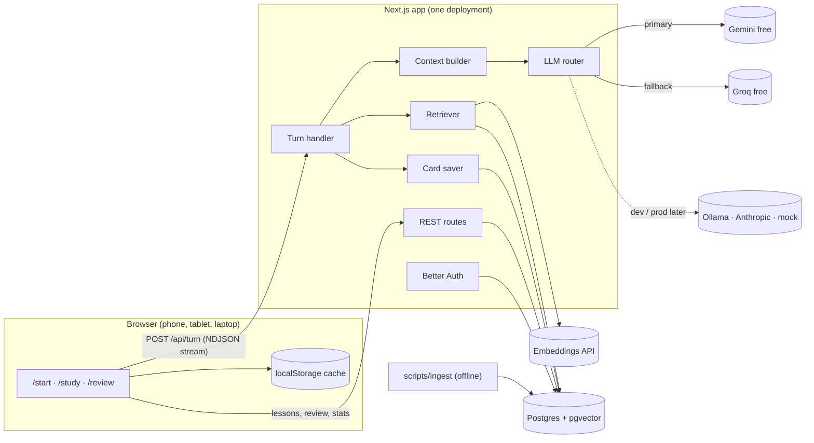

# Chronicle prototype: the end-to-end build plan

Status (20 Oct 2026): **phases 0–4 are built and run end to end** on free tiers. See "Build record" at the end for what changed from this plan, what was checked, and what is still open.

**Goal.** A working prototype that teaches history as cause and consequence and helps people *remember* it. A learner asks a question, gets a grounded lesson with sources, and comes back on any device to review what matters until it sticks.

**Shape.** One Next.js app and one Postgres database (with pgvector). The LLM and the embeddings run on free tiers for testing, behind a thin layer we can swap later. No microservices, no separate vector database, no agent framework.

---

## 0. The whole system on one page

| Piece | What we use | Why this and not something bigger |
|---|---|---|
| LLM layer | Our own ~150-line provider layer over the OpenAI-compatible Chat Completions API. Free Gemini Flash first, Groq as fallback, Ollama for offline work. The existing Anthropic and mock adapters stay. | Almost every free provider speaks this one API. The Director already consumes plain text deltas, so we need streaming text and nothing more. |
| System prompt | The current Director prompt, split into versioned modules and assembled into one static, cacheable string. Everything that changes per turn goes in the user message. | One prompt, many features. Every turn records the prompt version it used. |
| Knowledge base (RAG) | Postgres + pgvector. Hybrid search: vectors plus Postgres full text, merged with reciprocal rank fusion. Corpus: Wikipedia (CC BY-SA) and OpenStax World History (CC BY). | One database for app data and vectors. pgvector is fine up to millions of chunks. |
| Embeddings | Gemini `gemini-embedding-001` at 768 dimensions on the free tier, or Ollama `nomic-embed-text` (also 768) offline. A fake embedder for tests. | Free, good quality, and no heavy native packages in the server bundle. |
| Retention | Memory cards from every lesson, scheduled with FSRS (`ts-fsrs`), a daily review on `/review`, and retention stats. | Spaced retrieval practice is what makes knowledge last. Reading alone does not. |
| Accounts and sync | Better Auth (self-hosted, Postgres) with Google and email magic link, plus guests. Lessons live on the server, and localStorage stays as a cache. | The same lessons and reviews on a phone and a laptop. |
| Chat | Today's NDJSON streaming turn, plus server-side turn logs, bounded context, per-user limits and fallback. | It already streams and aborts well. It needs persistence and limits, not a rewrite. |
| Hosting (prototype) | Vercel Hobby + Neon Free + free LLM keys = $0. | Check the limits in section 16 before inviting testers. |

The demo that proves it works end to end is in section 1. Every phase in section 13 moves us toward it.

---

## 1. "Working end to end" means this script passes

1. On a laptop, a tester signs in with Google (or continues as a guest).
2. They ask "Why did Rome beat Carthage?".
   - The lesson streams from the **free Gemini tier**: an article, a cause map, and a prediction gate.
   - Its claims cite sources (`[S2]`). Clicking a citation shows the passage, the link and the licence.
3. When the lesson ends, a line says "6 ideas saved for review". The cards come from this lesson.
4. If Gemini returns 429 (rate limited), the same turn finishes on Groq, and the turn log records the switch.
5. The next day, on a phone, the tester signs in.
   - `/start` shows "6 to review · about 4 min" above the question box.
   - The lesson from yesterday is in "Continue", exactly as they left it, with their notes.
6. They review:
   - For each card they try to recall the answer, reveal it, and rate themselves. Quiz-style cards grade themselves.
   - Each card's next due date moves according to FSRS.
7. `/stats` shows: due today, a streak, and "remembered at 1 day / 1 week / 1 month".
8. An admin can open the turn log and see the prompt version, the provider, the model, latency, sources used, dropped lines and errors.

---

## 2. What exists today, and what is missing

| Area | Today (v0.1 + landing) | Missing for the prototype |
|---|---|---|
| Turn API | `app/api/turn/route.ts`. Anthropic only, or `MOCK_LLM=1` fixtures. Streams NDJSON lines, validated by `lib/director/pipeline.ts`. | Free providers, fallback, retries, per-user limits, turn logging, retrieval. |
| Prompt | `lib/director/system-prompt.ts`: one static string, cached. `lib/director/context.ts` builds the per-turn context. | Modules and a version. Pedagogy and citation rules. Sources, recent turns and learner profile in the context. |
| Contracts | `lib/contracts`: blocks, ops, `StreamLine` (`say`, `op`, `followup`, `done`) and UI events. | Additive only: a `card` line, a `sources` line, and `[S#]` citation markers in article markdown. |
| State | Zustand + localStorage (`chronicle:workspace`). Up to 8 archived lessons in `chronicle:lessons:v1`. | A server database, accounts, cross-device sync. |
| Memory | `mastery` per lesson: +0.25 / −0.35 per answer, no time component. | Spaced repetition across lessons, review logs, retention metrics. |
| Auth | `lib/auth`: an `AuthClient` interface with a localStorage placeholder. | A real implementation behind the same interface. |
| UI | Landing, `/start`, `/study` (reader, canvas, timeline, focus), chat dock, notes, quizzes, phone layout, Verdigris light/dark. | Citations, a review entry on `/start`, `/review`, `/stats`, sign-in wiring, PWA manifest. |

---

## 3. Architecture



**One turn, step by step:**
1. Check the session, the per-user limit and the request shape.
2. Decide whether this turn needs retrieval. A new question, `ask_why` and `expand_node` do. `quiz_result` and `predict_answer` do not.
3. Retrieve 4 to 8 chunks within a token budget, and number them S1 to S8.
4. Build the context: profile, lesson, recent turns, sources, input.
5. Stream from the primary provider. On 429, 5xx or a timeout *before the first valid line*, retry once on the fallback.
6. Parse and validate the lines with the existing pipeline. Strip citations that point to no source, and emit a `sources` line holding only the cited ones.
7. Forward the lines to the client. Save the `card` lines, and add the deterministic cards (section 7.2).
8. Write the turn log row.

---

## 4. LLM layer

### 4.1 Free providers to test with

| Role | Provider | Why | Limits (reported; check the console, never hard-code) |
|---|---|---|---|
| Primary | **Gemini API, Flash model** through its OpenAI-compatible endpoint `https://generativelanguage.googleapis.com/v1beta/openai/` | The best quality on a free tier, long context, good at strict JSON lines. The same key covers embeddings. | Flash and Flash-Lite are free. Third-party guides report about 10–15 requests a minute and a few hundred to ~1,500 a day per project, and they disagree. Pro models went paid-only in April 2026. |
| Fallback | **Groq** (`https://api.groq.com/openai/v1`), for example Llama 3.3 70B or gpt-oss-120b | Very fast, free, the same API. | About 30 requests a minute and around 1,000 a day for the larger models. **Tokens per minute (roughly 6k–12k) are the real cap**, so the fallback gets a smaller source budget. |
| Offline / dev | **Ollama** (`http://localhost:11434/v1`), an 8B-class model | No quota, works on a plane. | Weaker output. Only for UI work and plumbing. |
| Optional | OpenRouter `:free` models, Cloudflare Workers AI | More free capacity if we need it. | OpenRouter: 20 requests a minute, and 50 a day until the account has bought $10 of credits. |
| Later (paid) | Anthropic (the adapter already exists) or paid Gemini | Production quality and data privacy. | n/a |

> **Privacy:** Google's terms say content sent to the *unpaid* Gemini tier can be used to improve its products and may be read by human reviewers. In the EEA, Switzerland and the UK the paid-service terms apply even to unpaid use. Testers must not paste personal data. Move to a paid tier or another provider before real users.

Model ids change often. Read the current Flash id from Google AI Studio and the current Groq ids from the Groq console, and put them in env. Never put them in code.

### 4.2 The interface (`lib/llm/`)

```ts
// lib/llm/types.ts
export interface LlmRequest {
  system: string;          // static, cacheable
  user: string;            // per-turn context (section 5.2)
  maxTokens: number;
  temperature: number;
  signal: AbortSignal;
}
export interface LlmProvider {
  id: string;              // "gemini-flash", "groq-llama70b", "anthropic", "mock"
  stream(req: LlmRequest): AsyncIterable<string>;   // text deltas, nothing else
}
export class LlmError extends Error {               // so the router can decide
  constructor(msg: string, public kind: "rate_limit" | "server" | "timeout" | "auth" | "bad_request", public retryAfterMs?: number) { super(msg); }
}
```

Files:
- `openai-compatible.ts`: `fetch(POST {base}/chat/completions, stream: true)` plus a small SSE parser. It yields `choices[0].delta.content`, maps HTTP 429/5xx/401/400 to `LlmError` kinds, and reads `Retry-After`. Gemini, Groq, Ollama and OpenRouter all use this one file.
- `anthropic.ts`: the current `llmDeltas` moved here, unchanged.
- `mock.ts`: the current `mockDeltas`, unchanged.
- `router.ts`: builds the provider chain from env and runs the fallback policy.
- `config.ts`: reads and validates env with zod at startup, and fails with a clear message.

We write this by hand instead of using the Vercel AI SDK (now at v7). The app needs one capability, streaming text, from one API shape. ~150 lines we fully understand beats a framework that changes every major version. If we later need tool calling or images, revisit.

### 4.3 Router policy

- Try the providers in order: `LLM_CHAIN=primary,fallback`.
- Fall back only **before the first valid line has reached the client**. After that, a failure ends the turn with the existing calm "Something went wrong" `say`, so the stage never mixes two models' half-lessons.
- On `rate_limit`, wait up to `Retry-After` (capped at 3 s) once, then fall back.
- Each provider gets its own budgets: `maxTokens` (output) and `contextBudget` (input). Sources are trimmed first, then recent turns, then nothing else.
- Every attempt is logged on the turn: provider, model, status, latency, error kind.

### 4.4 Configuration (`.env.local`)

```bash
# chain, in order (names refer to the blocks below)
LLM_CHAIN=gemini,groq

LLM_GEMINI_BASE_URL=https://generativelanguage.googleapis.com/v1beta/openai/
LLM_GEMINI_API_KEY=...
LLM_GEMINI_MODEL=<current Flash id from AI Studio>
LLM_GEMINI_CONTEXT_BUDGET=12000
LLM_GEMINI_MAX_TOKENS=6000

LLM_GROQ_BASE_URL=https://api.groq.com/openai/v1
LLM_GROQ_API_KEY=...
LLM_GROQ_MODEL=<current 70B-class id from the Groq console>
LLM_GROQ_CONTEXT_BUDGET=5000
LLM_GROQ_MAX_TOKENS=3500

EMBED_PROVIDER=gemini            # gemini | ollama | fake
EMBED_MODEL=gemini-embedding-001
EMBED_DIM=768

DATABASE_URL=postgres://...
BETTER_AUTH_SECRET=...
GOOGLE_CLIENT_ID=...
GOOGLE_CLIENT_SECRET=...

MOCK_LLM=1                       # still wins over everything, for UI work and tests
```

Old setups keep working: with `ANTHROPIC_API_KEY` and `CHRONICLE_MODEL` set and no `LLM_CHAIN`, the chain is `anthropic`.

### 4.5 Tests

- The SSE parser, against recorded streams from each provider (saved under `tests/fixtures/llm/`).
- Router: rate limit, then fallback; failure after the first line, then no fallback; abort stops both.
- No network in unit tests.

---

## 5. System prompt that scales

### 5.1 Static modules (`lib/prompts/director/`)

| Module | Holds | Status |
|---|---|---|
| `role.ts` | Who the Director is and the purpose (reason about causes, not trivia). | moved from today's prompt |
| `protocol.ts` | The output lines, including the new `card` line, and the order. | moved + extended |
| `blocks.ts` | The seven block specs. | moved |
| `grounding.ts` | How to use `<sources>`, cite `[S#]`, combine `[S#]` with `[E]/[L]/[C]`, and what to do when the sources are silent. | **new** |
| `pedagogy.ts` | Retention rules (below). | **new** |
| `levels.ts`, `style.ts`, `honesty.ts` | As today. | moved |

`index.ts` joins them into one string and exports `PROMPT_VERSION`, a short hash of that string. Each turn log stores the version, so we can compare versions with real data. Feature switches (`rag`, `cards`) are build-time options, so the static prompt stays identical across turns and keeps caching.

**Pedagogy rules (new module), kept short:**
1. A lesson teaches **3–5 key ideas**. Name them in the brief section. Every other block serves them.
2. Explain with causes and consequences, never lists of facts. Every date is tied to an event that matters.
3. Ask before telling at a real turning point (the predict gate). The learner's guess makes the answer stick.
4. Connect to what the learner already studied. `<profile>` lists their recent topics. Use one link ("This is about 40 years after the Gracchi you studied") when it is honest.
5. After a new lesson, emit **3–6 `card` lines**: the ideas worth remembering, phrased as questions that need reasoning (why, what led to, what changed). Answers have at most 2 sentences, and every card cites its block (and source when it has one).
6. Use concrete, specific examples. Do not stack abstractions.

### 5.2 The per-turn context (`lib/director/context.ts`)

Sections, in order of how fast they are trimmed when over budget (sources are trimmed first):

```
<profile>   level, up to 10 recent lesson topics with periods, 5 weakest cards   (~200 tokens)
<lesson>    topic, period, stage blocks as id | type | title, next_block_id    (~400)
<recent>    last 4 exchanges: learner message + Director "say"                 (~400)
<sources>   S1..S8: title · section · period · text                            (budget-driven, ≤ 3,000)
<source_text> pasted reading (as today, ≤ 8,000 chars)
<input>     learner message or UI event (+ detail)
```

A lesson never sends the full chat transcript. The stage summary and the last 4 exchanges are enough, so context cost stays flat no matter how long a lesson gets. This is what makes the chat scale.

### 5.3 Contract additions (all additive and optional)

```ts
// lib/contracts/ops.ts, new StreamLine members
{ t: "card", card: {
    id: string,                         // "c1"…, unique within the turn
    kind: "why" | "consequence" | "sequence" | "anchor" | "significance",
    front: string /* ≤160 */, back: string /* ≤280 */,
    source_ref: { block: string, node: string | null },
    cites?: string[]                    // ["S2"]
} }
{ t: "sources", items: [{ id: "S2", title, url, license, excerpt }] }   // sent by the server, never by the model
```

- `TurnRequest` gains optional `lesson_id`, `turn_id` and `topic`. The server reads the recent exchanges for `<recent>` from its own `turns` table by `lesson_id`, so the client never has to send the transcript.
- Citation markers `[S2]` sit in article markdown and in edge `why` text, after the `[E]/[L]/[C]` tag.
- `lib/entities.ts` already rewrites `[E]` to a `conf:` link. Add `[S2]` → `src:S2` the same way, and render it as a small superscript button in `Markdown.tsx`.
- The client stores the turn's `sources` on the lesson, so citations still work after a reload.
- `card` lines are saved by the server and passed through to the client only to show "6 ideas saved".

### 5.4 Making free models behave

- Keep the protocol strict, short and first in the prompt. Add **one complete example turn** (5–7 lines) at the end of `protocol.ts`. Small models copy examples better than they follow rules.
- The existing pipeline already drops invalid lines. Add two safety nets:
  - **One automatic retry** when a turn produces a `say` but no valid `op` on a new question.
  - **Light repair** before validation: strip code fences, and split two objects found on one line.
- Track the dropped-line rate per provider and model in the turn log. A model with more than 10% dropped lines is not fit for the chain.
- Temperature 0.3. Use the model's JSON mode only if it accepts NDJSON, because most JSON modes force a single object.

### 5.5 Evals (`scripts/eval.ts`, `npm run eval -- --chain gemini`)

- 15–20 golden prompts in `tests/evals/prompts.yaml`: the fixture topics, a dynasty question, a vague question, a pasted paragraph, a quiz request, and an ask-why event.
- Automatic checks per turn:
  - Valid line rate.
  - Exactly one `say`, and it comes first.
  - Block count is 4 or fewer.
  - No year 0, and each cause map has exactly one event node.
  - Every `[S#]` exists, and at least 60% of article sentences carrying `[E]` also cite a source.
  - 3–6 cards on new lessons.
  - Latency.
- The script writes a table to `docs/evals/<date>-<prompt version>.md`. We compare versions before changing the prompt or the provider order.

---

## 6. Knowledge base (RAG)

### 6.1 Corpus and licences

| Source | Licence | Use | Prototype scope |
|---|---|---|---|
| Wikipedia, plain text via its API | CC BY-SA 4.0: attribution, share-alike on what we redistribute | Main narrative source | ~150 curated articles: the 3 fixture topics, plus a world-history spine (major empires, wars, revolutions), listed in `content/corpus/topics.yaml` |
| OpenStax *World History* Vol. 2 | CC BY 4.0 (stated in the book's preface) | Textbook-level explanations | the whole book |
| OpenStax *World History* Vol. 1 | Verify on openstax.org first (secondary sites disagree) | as above | after the licence is confirmed |
| Wikidata | CC0 | Later: checking dates, succession and reigns | phase 4, optional |

Every chunk keeps the source title, URL, revision or edition, licence and attribution text. The citation popover shows them. The ingest script sends a descriptive User-Agent to Wikipedia and stays at about 1 request a second.

### 6.2 Ingestion pipeline (`scripts/ingest/`, run offline)

1. **fetch**: download each source to `content/corpus/raw/` (git-ignored) with its metadata.
2. **clean**: strip navigation, references and infoboxes, and keep the heading hierarchy.
3. **chunk**:
   - About 250 words (~350 tokens), never more than 500 tokens.
   - Split on paragraphs, with a 1-sentence overlap.
   - Each chunk carries its heading path ("Second Punic War › Hannibal in Italy").
4. **enrich**:
   - `period_from` / `period_to` from the years in the text, using the existing `yearsInText` in `lib/period.ts`.
   - Entity names from the page's links.
5. **embed**: batches of up to 100, `taskType = RETRIEVAL_DOCUMENT`, 768 dimensions, throttled to the free quota.
6. **upsert** by content hash, so a re-run only embeds what changed and an interrupted run resumes.
7. **report**: documents, chunks, tokens, failures.

Rough size: ~150 articles + one textbook ≈ 5–8k chunks ≈ 2–3M tokens. That is one throttled overnight run on the free tier, or minutes on Ollama.

### 6.3 Tables

```sql
create extension if not exists vector;

create table source_docs (
  id text primary key,                 -- "wiki:Second_Punic_War", "openstax:wh2:ch3"
  kind text not null,                  -- wikipedia | openstax | wikidata
  title text not null, url text not null,
  license text not null, attribution text not null,
  revision text, fetched_at timestamptz not null
);

create table chunks (
  id bigserial primary key,
  doc_id text not null references source_docs(id) on delete cascade,
  ord int not null,
  heading_path text not null,
  text text not null,
  tokens int not null,
  period_from int, period_to int,      -- BCE negative, no year 0 (same rule as the app)
  entities text[] not null default '{}',
  content_hash text not null,
  embedding vector(768),
  embedding_model text not null,
  tsv tsvector generated always as (to_tsvector('english', heading_path || ' ' || text)) stored,
  unique (doc_id, ord)
);
create index on chunks using hnsw (embedding vector_cosine_ops);
create index on chunks using gin (tsv);
create index on chunks (period_from, period_to);
```

### 6.4 Retrieval (`lib/rag/retrieve.ts`)

1. **Query text**: the learner's message (or the event's selection or node label) + the lesson topic.
2. **Embed** the query with `taskType = RETRIEVAL_QUERY`. Cache by hash for a day.
3. **Two searches**, each top 24, filtered by `embedding_model = current`:
   - vector: `order by embedding <=> $q`
   - keyword: `websearch_to_tsquery('english', $text)` ranked with `ts_rank_cd`.
4. **Fuse** with reciprocal rank fusion (k = 60), with a small boost when the chunk's period overlaps the lesson's period.
5. **Diversify**: at most 2 chunks per document.
6. **Fit** the provider's source budget: usually 6 chunks on Gemini and 3 on Groq.
7. Return `[{ sid: "S1", chunkId, docId, title, heading, text, url, license }]`.

There is no reranker model and no query-rewriting LLM call in the prototype. Both add a request against a small free quota. Add them only if evals show bad recall.

### 6.5 When the sources do not cover something

The grounding module says:
- Use the sources for facts and cite them.
- If the sources are silent, general knowledge is allowed, but tag it `[L]` and leave it uncited.
- Never cite a source for something it does not say.

The server deletes any `[S#]` that was not in the context, and the eval counts how often that happens.

---

## 7. The retention loop (the reason this product exists)

### 7.1 What the research says, and what we build for it

| Principle | What it means | Feature |
|---|---|---|
| Retrieval practice (testing effect) | Pulling an answer from memory strengthens it far more than re-reading. | Review cards ask before they show. Quizzes stay. |
| Spacing | Reviews spread out over growing gaps beat cramming. | FSRS schedules every card. |
| Elaboration ("why?") | Explaining causes links facts together, so they are easier to recall. | Cards are mostly why, what led to, and what changed. Cause maps stay. |
| Generation / prediction | Guessing before seeing the answer improves memory of the answer. | Predict gates (they exist). Recall-first cards. |
| Interleaving | Mixing topics in practice improves telling them apart. | The review queue mixes cards from all lessons. |
| Dual coding | Words plus a picture of the structure. | Timeline and cause map (they exist). |
| Feedback | Immediate, with the reason. | Every card has an answer that explains, plus a link back to its block. |
| Connecting to known material | New ideas attach to old ones. | `<profile>` recent topics. "Meanwhile" and anchor callouts. |

### 7.2 Where cards come from

1. **The model's `card` lines** (3–6 per new lesson; pedagogy rule 5). These are the key ideas.
2. **Deterministic cards**, with no extra LLM call:
   - Each timeline with 3 or more events gives one `sequence` card: put 3–5 events in order. It is checked automatically with the existing `checkChronology`.
   - Each quiz item becomes a card of the same kind, checked automatically.
   - If the model sent no cards, take the top 4 cause-map edges with `E` or `L` confidence and ask "How did *from* lead to *to*?". The answer is the edge's `why`.
3. **The learner**: a "Remember" note adds a card whose front is "What do you remember about: *quote*?".

Duplicates are skipped per user, by a hash of the normalised front. The daily limit for new cards (default 10) keeps reviews short.

### 7.3 Scheduling (`lib/review/`)

- `ts-fsrs` 5.4.x with default parameters and a desired retention of 0.9.
- Ratings:
  - Auto-checked cards: correct is Good, and correct in under 5 s is Easy. Wrong is Again.
  - Free-recall cards: the learner picks Again, Hard, Good or Easy after the answer is revealed.
- The queue lists due cards ordered by due time and mixed across lessons, up to 60 reviews and 10 new cards a day (settings).
- Every rating writes a `review_logs` row, which is append-only. It is the raw data for retention stats and for tuning FSRS later.

### 7.4 Review UX (`/review`, phone first)

1. The card shows its front and the lesson it came from. Optionally the learner types an answer.
2. "Show answer" reveals the back, the cited block, and a "Go to lesson" link.
3. Four large rating buttons, with the next interval shown on each ("Good · 4 days").
4. A session is 5–10 minutes. The end screen shows how many were remembered and the next due time.
5. A "Check my answer" button (optional, phase 4) sends the typed answer and the back to the LLM for one sentence of feedback. It is off by default to save quota.

On `/start`, a review card sits above the question box when something is due: "6 to review · about 4 min". When a learner reopens a lesson with due cards, ask one of them first, as a warm-up (phase 3 stretch).

### 7.5 Measuring retention

- **True retention**: the share of reviews of mature cards rated Hard or better. Show it by interval: 1–2 days, 3–7 days, 8–30 days, and over 30 days.
- Per lesson: "remembered 5 of 6".
- `/stats` shows due today, the streak, retention by interval, and cards learned.
- The product question "do people actually retain?" becomes a SQL query on `review_logs`.

---

## 8. Data model (Postgres, Drizzle ORM)

Better Auth creates its own `user`, `session`, `account` and `verification` tables. Ours:

| Table | Key columns | Notes |
|---|---|---|
| `profiles` | `user_id` PK, `level`, `theme`, `daily_new_limit`, `timezone` | Created on first sign-in or for a guest. |
| `lessons` | `id` PK, `user_id`, `topic`, `period_from`, `period_to`, `snapshot jsonb`, `version int`, `updated_at` | `snapshot` is today's `PersistedWorkspace` (blocks, chat, notes, mastery, sources), unchanged. |
| `turns` | `id`, `lesson_id`, `user_id`, `request jsonb`, `lines jsonb`, `prompt_version`, `attempts jsonb` (provider, model, status, latency, error), `source_ids text[]`, `dropped_lines int`, `tokens_in`, `tokens_out`, `created_at` | The debugging and evaluation log. It also drives rate limits. |
| `cards` | `id`, `user_id`, `lesson_id`, `kind`, `front`, `back`, `payload jsonb` (options or events for auto-checked kinds), `source_ref jsonb`, `cites text[]`, `front_hash`, FSRS fields (`due`, `stability`, `difficulty`, `elapsed_days`, `scheduled_days`, `reps`, `lapses`, `state`, `last_review`), `suspended`, `created_at` | Unique on `(user_id, front_hash)`. |
| `review_logs` | `id`, `card_id`, `user_id`, `rating`, `correct`, `answer_text`, `duration_ms`, `elapsed_days`, `scheduled_days`, `reviewed_at` | Append-only. |
| `source_docs`, `chunks` | section 6.3 | Shared by all users. |

Migrations live in `drizzle/`, made by `drizzle-kit`. Dev uses Docker `pgvector/pgvector` (or a Neon branch). Tests use PGlite in memory with its vector extension, so they need no Docker.

---

## 9. Accounts and multi-device

**Auth.**
- Better Auth 1.7 with the Drizzle adapter: Google OAuth, plus an email magic link (in dev the link prints to the server log; in prod it goes through an email provider's free tier).
- The anonymous plugin lets guests use everything. Signing in later links the guest's data to the account. Check the plugin's current docs before building.
- Implement the existing `AuthClient` interface in `lib/auth/`, so the landing's sign-in card works unchanged.

**Sync.** Simple on purpose:
- For signed-in users and guests alike, the server is the source of truth. The zustand store and localStorage remain a fast cache.
- On first sign-in, upload the lessons already in localStorage (`chronicle:lessons:v1` and the current workspace) once.
- Save the lesson snapshot after every finished turn, after local edits (notes, quiz answers, undo; debounced 2 s), and when the tab is hidden.
- Use a `version` number: `PUT /api/lessons/:id` with `baseVersion`. If the server copy is newer, it answers 409. The client then loads the server copy and shows "Updated from your other device".
  - This is last-write-wins at the lesson level, which is fine for one person on two devices. Reviews never conflict, because they are append-only logs.

**Devices.**
- The phone layout exists. `/review` and `/stats` are built phone-first.
- Every control is at least 44 px. Check at 390, 768 and 1440 px in light and dark.
- A PWA manifest and icons make the app installable on a phone home screen, where daily review lives. Offline review is out of scope for the prototype.

---

## 10. Chat at scale

- **Bounded context**: section 5.2. The cost per turn does not grow with lesson length.
- **Turn ids**: the client sends a `turn_id`. The server ignores duplicates, so a double tap does not run two turns.
- **Limits**: counted from the `turns` table with no Redis.
  - Signed-in: 40 turns a day and 6 a minute.
  - Guest: 10 a day.
  - Hitting a limit gives a clear message in the dock, not an error.
- **Streaming**: NDJSON over `fetch` stays. It works on every device and through proxies (`X-Accel-Buffering: no` is already set). Abort and retry behave as today.
- **Errors**: rate limited, provider down and invalid output each get one calm sentence. The turn log has the details.
- **Admin view**: `/admin/turns`, behind an env allow-list of emails. It lists recent turns with prompt version, provider, latency, sources and dropped lines, and opens the raw lines.

---

## 11. API routes

| Route | Purpose |
|---|---|
| `POST /api/turn` | As today, plus auth, limits, retrieval, fallback, turn log and card saving. |
| `GET /api/lessons` · `GET/PUT/DELETE /api/lessons/:id` | The lesson list and snapshots, with version checks. |
| `POST /api/lessons/import` | One-time upload of the localStorage lessons. |
| `GET /api/review/queue?limit=20` | Due cards plus the day's new cards. |
| `POST /api/review/:cardId` | `{ rating, correct?, answer_text?, duration_ms }` → next due date. |
| `GET /api/stats` | Due today, streak, retention by interval. |
| `GET /api/sources/:docId` | Source details for a citation, when the lesson's cached copy is missing. |
| `/api/auth/*` | Better Auth's handler. |

Every handler validates its input with zod, like `TurnRequest` today. Read `node_modules/next/dist/docs/` before writing routes (AGENTS.md).

---

## 12. Code layout

```
lib/llm/            types, openai-compatible, anthropic, mock, router, config
lib/prompts/director/  role, protocol, blocks, grounding, pedagogy, levels, style, honesty, index (+ PROMPT_VERSION)
lib/director/       context.ts (new sections), pipeline.ts (+ repair, citations, cards), stream-parser.ts
lib/rag/            embed.ts (gemini | ollama | fake), retrieve.ts, budget.ts
lib/review/         cards.ts (from lines and blocks), fsrs.ts (wrapper), queue.ts, stats.ts
lib/db/             schema.ts, client.ts
lib/auth/           better-auth server config + an AuthClient over its client
app/api/...         routes from section 11
app/review/page.tsx, app/stats/page.tsx, app/admin/turns/page.tsx
scripts/ingest/     fetch.ts, clean.ts, chunk.ts, embed.ts, run.ts
scripts/eval.ts
content/corpus/topics.yaml
drizzle/            migrations
```

Existing files that change:
- `app/api/turn/route.ts`: uses the router, retrieval, logging and cards.
- `lib/director/system-prompt.ts`: becomes a re-export of `lib/prompts/director`.
- `lib/contracts/ops.ts`: the two new lines.
- `lib/entities.ts` and `components/blocks/Markdown.tsx`: citations.
- `lib/store/workspace.ts`: server sync.
- `components/Home.tsx`: the review entry.
- `lib/auth/index.ts`: the real client.

---

## 13. Build phases

Each phase ends with something a person can try, plus tests. The estimates assume one developer.

### Phase 0: free LLM end to end (2–3 days)
- `lib/llm` with the OpenAI-compatible adapter, the router and config. The current Anthropic and mock code moves in unchanged.
- The prompt split into modules with `PROMPT_VERSION`, plus the example turn. No new rules yet.
- `scripts/eval.ts` with 15 golden prompts, and a baseline run on Gemini and on Groq.
- **Done when:**
  - `/study` produces a full lesson from the free Gemini tier.
  - Forcing a 429 finishes the turn on Groq.
  - Evals show 95% or more valid lines on Gemini.
  - The unit tests for SSE parsing and the router pass.

**Status: done (20 Oct 2026).** See the build record at the end.

### Phase 1: database, accounts, sync (3–4 days)
- Postgres and the Drizzle schema (profiles, lessons, turns), Better Auth (Google, magic link, guest), and the `AuthClient` implementation.
- Lesson routes, the localStorage import, and versioned saves. Turn logging. Limits. The `/admin/turns` view.
- **Done when:**
  - A lesson started on a laptop opens on a phone, with its notes.
  - A 409 conflict shows "Updated from your other device".
  - Limits trigger.
  - Every turn has a log row.

### Phase 2: knowledge base and citations (3–4 days)
- The ingest scripts and `topics.yaml`. Ingest Wikipedia (~150 articles) and OpenStax Vol. 2.
- Retrieval, the `grounding` module, the `sources` line, citation validation, the citation popover, and source budgets per provider.
- **Done when:**
  - The fixture questions produce lessons that cite real passages.
  - Evals show at least 60% of `[E]` sentences cited and 0 invalid citations reaching the client.
  - Retrieval tests pass on PGlite.

### Phase 3: retention loop (3–4 days)
- The `card` line and the `pedagogy` module. Deterministic cards. The cards and review_logs tables, the FSRS wrapper, and the queue.
- `/review` (phone first), the review entry on `/start`, `/stats`, and "6 ideas saved" after a lesson.
- **Done when:** the section 1 script runs from step 3 to step 7. With a test clock (simulated time), cards come due on the expected days.

### Phase 4: hardening and first testers (2–3 days)
- The PWA manifest. Error states for each failure. A Playwright end-to-end run of the section 1 script with `MOCK_LLM=1`. Screenshots at three widths in two themes.
- Deploy: Vercel + Neon. Run the ingest against Neon.
- Optional: "Check my answer", the lesson warm-up question, and Wikidata date checks.
- **Done when:** five testers can use it for a week, and `review_logs` gives a first retention-by-interval table.

**Total:** about 2.5–3.5 weeks to a prototype that real testers can use.

---

## 14. Testing

| Level | What | Tools |
|---|---|---|
| Unit | SSE parser, router, prompt assembly and version, chunker, RRF, budget trimming, citation validator, card extraction, FSRS wrapper, limits | vitest (as today) |
| Integration | Schema and migrations, retrieval SQL with fake embeddings, lesson version conflicts, review → next due | vitest + PGlite with vector |
| End to end | The section 1 script with `MOCK_LLM=1` (mock fixtures gain `card` lines) | Playwright with system Chrome (as in `docs/landing-screens/`) |
| Model quality | Golden prompts per chain and prompt version | `npm run eval` |

The existing 158 tests keep passing at every phase.

---

## 15. Scaling path, and what we are not building

**Add these only when a measurement says so:**

| Signal | Then add |
|---|---|
| Free quotas run out with real testers | A paid Gemini tier or Anthropic as the primary. The router already supports it. |
| Evals show poor retrieval | A reranker step, or query rewriting. |
| More than one server instance needs shared limits | Redis or Upstash for rate limiting. |
| Ingest takes hours or runs often | A job queue. Until then, a script. |
| Tens of millions of chunks | Partition `chunks`, tune HNSW. Still pgvector. |
| People need it on trains | Offline review in the PWA (cache the due queue, sync logs later). |

**Not building:** microservices, a separate vector database, LangChain or agent frameworks, multi-agent pipelines, fine-tuning, real-time collaboration, CRDT sync, native apps, or payments.

---

## 16. Decisions for the owner

1. **Provider order**: Gemini Flash free first and Groq second (recommended), or the other way round.
2. **Free-tier privacy**: testers know that unpaid Gemini prompts may be used by Google and seen by reviewers. Confirm that this is acceptable for testing.
3. **Hosting**: Vercel Hobby + Neon Free (recommended for the prototype; Hobby is for non-commercial use, so check its function time limits for streaming), or one small Node server.
4. **Sign-in methods**: Google plus email magic link plus guests (recommended), or Google only.
5. **Corpus scope**: the fixture topics plus a world-history spine (recommended), or a narrower first region. Confirm the OpenStax Vol. 1 licence before ingesting it.
6. **Daily limits**: 40 turns, 10 new cards and 60 reviews per user (recommended defaults).

---

## Build record (20 Oct 2026)

### What runs now

- **LLM.** `lib/llm/` (adapters, router, config), with the chain set in `.env.local`:
  - **Primary:** Cloudflare Workers AI `@cf/openai/gpt-oss-120b` with low reasoning effort.
  - **Fallback:** OpenRouter `google/gemma-4-31b-it:free`.
  - **Gemini:** not used. The key provided belongs to a prepaid project with no credits, so every call answers 402. A key from a project without billing gets the free tier.
  - **Wireflow:** not used. The key works, but Wireflow only runs workflows asynchronously, so it can't stream a lesson.
- **Prompt.** It is now `lib/prompts/director/`: 11 modules including `GROUNDING` and `PEDAGOGY` (key ideas and memory cards), plus a worked example. The version is logged with every turn.
- **Repair before validation** (`lib/director/repair.ts`) fixes these slips:
  - confidence words instead of E/L/C;
  - over-long labels;
  - callouts without a title;
  - years written as text;
  - missing `when`/`t_offset`;
  - lineage generations, worked out from parent links.

  The stream parser also closes an object whose final `}` the model forgot, instead of losing every line after it.
- **Database.** Postgres 16 + pgvector via `docker compose up -d db` (port 5433), with Drizzle migrations in `drizzle/` that are applied at startup. Without `DATABASE_URL`, everything stays in the browser as before.
- **Accounts.** Better Auth: guests by default, email link (printed in the server log in development), and Google when configured. A guest's lessons, turns, cards and reviews move to the account they sign in to.
- **Sync.** Lessons are saved with versions, and a newer copy from another device wins, with a notice. The browser's earlier lessons upload once.
- **Turn log.** Every turn is logged (`/admin/turns`). Per-user limits are 20 turns a day for guests, 60 for accounts, and 6 a minute.
- **Knowledge base.**
  - **Corpus:** 43 Wikipedia articles (`content/corpus/wikipedia.txt`), about 2,500 passages, embedded with Cloudflare `@cf/baai/bge-m3` (1,024 dimensions, about 1,075 neurons per million tokens; the whole corpus cost about 550). Run `npm run ingest`, which is resumable and polite to Wikipedia.
  - **Retrieval:** hybrid (vector plus OR-keyword, reciprocal rank fusion, period boost, at most 2 passages per article, 2,200-token budget).
  - **Citations:** `[S2]` becomes `[S:<chunk id>]` in article and callout markdown; others are removed. A server-only `sources` line follows, and the reader shows numbered citations with a popover.
- **Retention.**
  - **Cards:** from the Director's card lines, plus ordering cards from timelines, quiz items, a cause-map fallback, and "Remember" notes.
  - **Scheduling:** FSRS (`ts-fsrs`, 90% target retention).
  - **Pages:** `/review` (recall first, then rate with the next interval shown; quiz-type cards check themselves), `/stats` (streak, retention by interval, per lesson), and the review prompt on `/start`.
- **PWA.** A manifest (opens `/start`), icons, and the Apple touch icon.

### What was checked

- 243 unit and integration tests, including PGlite with pgvector, a full guest → email link → account flow through Better Auth, retrieval, and FSRS with a simulated clock.
- `tsc`, `eslint`, and `next build`.
- `npm run e2e`: the section 1 script with the mock Director passes all 9 steps:
  1. a guest session starts;
  2. a lesson streams;
  3. it is saved on the server;
  4. its cards are offered on `/start`;
  5. an email sign-in keeps them;
  6. a full review runs;
  7. `/stats` counts it;
  8. the same lesson opens on a phone;
  9. 24 screenshots are saved in `docs/screens/prototype/`.
- Live, on the free chain:
  - **Lessons:** real lessons in `/study`, including topics outside the fixtures.
  - **Fallback:** a forced 429 finished on Cloudflare.
  - **Sources and cards:** 6 sources and 11 citations on one lesson, and 3–4 cards per new lesson.
  - **Across devices:** a lesson created on one device opened on a phone after an email sign-in.
- Evals (`docs/evals/`):
  - **Earlier prompt (`director-45140c8c`):** 16 turns, 99% valid lines, 12 of 16 passing every check. The 4 misses were fixed, and all 4 pass on `director-d731f1e8`.
  - **Prompt with sources and cards (`director-d8f22664`):** 3 turns, 96.8% valid lines, 13 citations kept and 0 removed. The one drop (lineage `gen` as text) is now repaired.

### Different from the plan

- **Providers:** Cloudflare first, for the reasons above, instead of Gemini and Groq.
- **Embeddings:** `bge-m3` at 1,024 dimensions instead of 768, because it is 5.6 times cheaper per token on Cloudflare than `bge-base` and stronger.
- **Source budget:** one budget for all providers (`RAG_SOURCE_TOKENS`), not one per provider.
- **Card lines** reach the client too: the chat dock lists them as "To remember".
- **Eval cases** live in `tests/evals/cases.ts` (no YAML dependency).

### Known limits and open items

- **Latency.** The free gpt-oss model takes about 8–29 s to its first line and 18–55 s for a whole lesson, slower with sources. A paid Flash-class model would be far faster, with no code change (`LLM_CHAIN`).
- **Quota.** The free Cloudflare allowance (10,000 neurons a day) covers roughly 30–40 lessons a day across all users. When it runs out, OpenRouter's free models take over (about 50 requests a day, sometimes rate-limited upstream).
- **Cloudflare stream bug.** On Cloudflare, Llama 3.3 70B, Llama 4 Scout, Mistral Small 3.1 and Qwen3 30B stream JSON pieces as typed values, which corrupts lessons. The adapter refuses such streams loudly. gpt-oss and Qwen 3.8 are clean.
- **Not done:**
  - **Corpus:** OpenStax ingestion (Vol. 2 is CC BY 4.0; Vol. 1's licence is still to confirm).
  - **Lessons:** the lesson warm-up question.
  - **Review:** "Check my answer" grading of a typed answer.
  - **Facts:** date checks against Wikidata.
  - **Real-world setup:**
    - a full 16-turn eval on the latest prompt (run `npm run eval` after the daily quota resets);
    - Google OAuth and real emails (set `GOOGLE_*` and `RESEND_API_KEY`/`EMAIL_FROM`);
    - deploying (Vercel + Neon; set `DATABASE_URL`, `BETTER_AUTH_URL`, and run `npm run ingest` against it).

## Sources (checked 19 Oct 2026)

- Gemini API OpenAI compatibility: https://ai.google.dev/gemini-api/docs/openai
- Gemini API additional terms (unpaid services and data use): https://ai.google.dev/terms
- Gemini Embedding GA (free tier, 768/1536/3072 dimensions): https://developers.googleblog.com/en/gemini-embedding-available-gemini-api/
- Gemini free tier changes, April 2026 (third-party): https://agentdeals.dev/gemini-api-pricing-changes
- Groq free tier (third-party summaries; the console is authoritative): https://benchlm.ai/md/free-tier/groq.md
- OpenRouter limits: https://openrouter.ai/docs/api/reference/limits
- Neon Free plan (pgvector included; storage raised to 1 GB on 2 Oct 2026): https://neon.com/docs/changelog/2026-10-02
- OpenStax World History Vol. 2 licence (CC BY 4.0): https://openstax.org/books/world-history-volume-2/pages/preface
- ts-fsrs (FSRS for TypeScript, MIT): https://github.com/open-spaced-repetition/ts-fsrs
- Package versions checked on npm on 19 Oct 2026:
  - `ts-fsrs` 5.4.2
  - `drizzle-orm` 0.45.4
  - `better-auth` 1.7.10
  - `@electric-sql/pglite` 0.5.10
  - `ai` 7.0.143 (not used, see 4.2)
